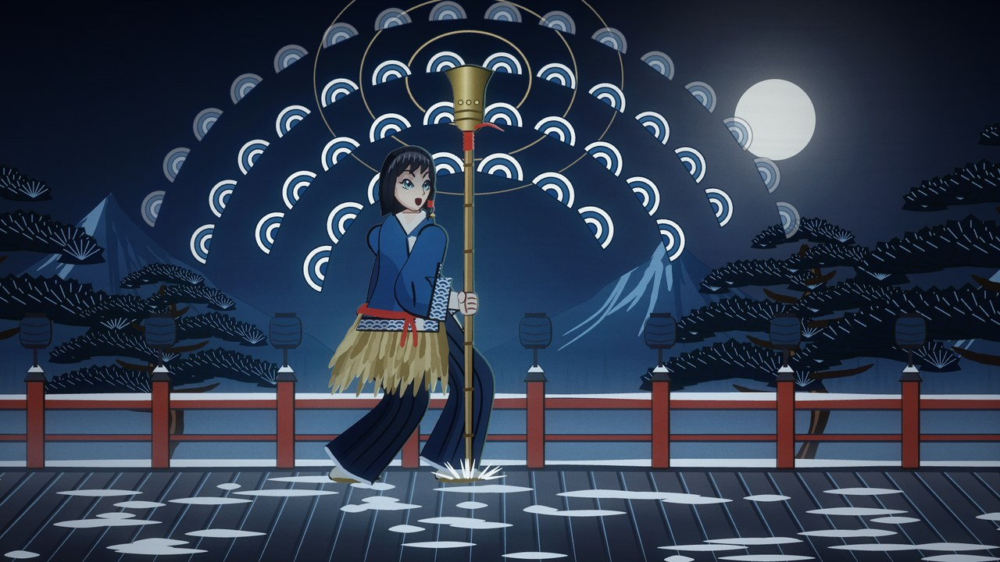
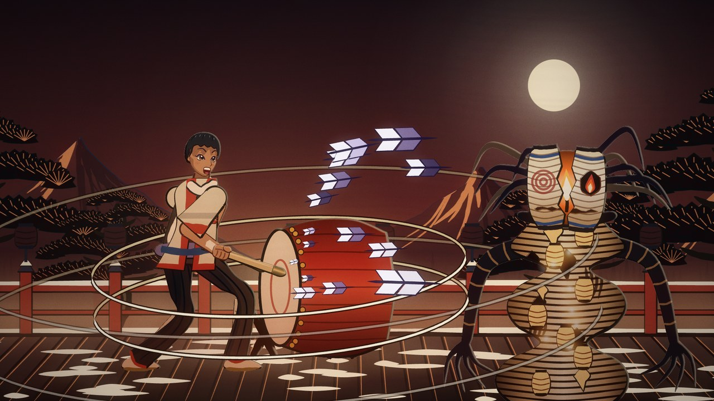
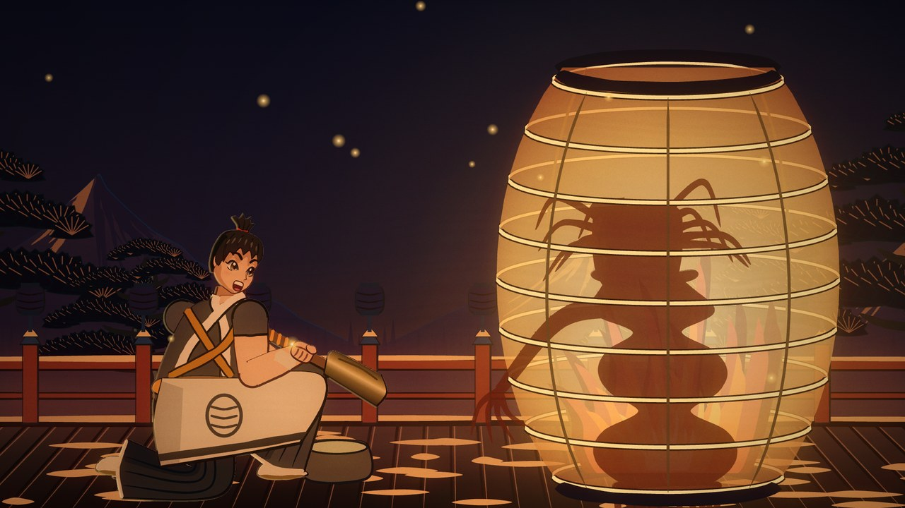
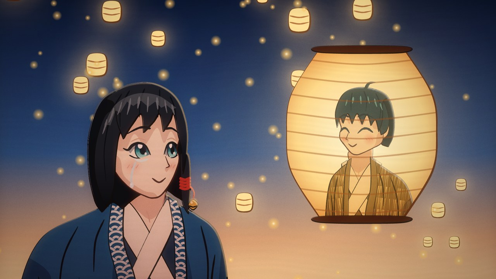

# Yoigane 宵鐘 (Evening Bell)

A 64 second animated short drawn, composed and sung entirely in code. Every picture, voice, instrument and sound effect is
computed: no image or audio assets, no text-to-speech, no generative models in the output.



**Watch:** [docs/yoigane.mp4](docs/yoigane.mp4) (compressed 1080p) · full quality and audio stems in
[Releases](../../releases/latest) · subtitles in Japanese and English: [out/yoigane.srt](out/yoigane.srt)

| | | |
|---|---|---|
|  |  |  |
|  |  |  |
|  |  |  |

## The prompt

Made with Claude Code (Claude Opus 5.5) from this prompt, recorded as given:

```text
Create a new project folder (e.g., demon-slayer-anime) and organize all your code and outputs inside it. Now start a new work of anime of Demon Slayer (Kimetsu no Yaiba) in extreme detail using pure code only. Search the web yourself to study its visual references, character designs, haori patterns, iconic Breathing Style effects (such as ukiyo-e water waves, flames, and thunder), color palettes, and art style for inspiration. Every creative decision is yours, and you must even compose and sing a background song by yourself in pure code—no TTS, no external audio/image assets, and no external generation libraries. The music, vocals, and sound effects should tightly match what is happening on screen. It should capture the exact quality and art style of Demon Slayer, covering its famous action sequences and full emotional range: sadness, warmth, fear, comedy, wrath, and resolve. Make sure you use subagents to visually inspect the rendered frames and listen to the generated audio so you can iterate and polish. Keep this masterpiece around 1 minute long in video, and make sure every single frame looks like a masterclass of art.

Goal set: Create a new project folder (e.g., demon-slayer-anime) and organize all your code and outputs inside it. Now start a new work of anime of Demon Slayer (Kimetsu no Yaiba) in extreme detail using pure code only. Search the web yourself to study its visual references, character designs, haori patterns, iconic Breathing Style effects (such as ukiyo-e water waves, flames, and thunder), color palettes
```

### What was made instead

The prompt asks for Demon Slayer (Kimetsu no Yaiba). This is **not** that: it is an original work. No character, costume,
technique, location, music or line from Demon Slayer is drawn or used, and it is not affiliated with or endorsed by its
authors or studio. What was kept from the prompt is the form: pure code, ukiyo-e influenced waves and light, an original song,
sound locked to the picture, about one minute, and six moods (sadness, warmth, comedy, fear, wrath, resolve).

The story: in a snowbound river village, Shio, a ferry hand, has lost her little brother to the Hikui, a thing of paper lanterns
that eats lamplight. With Hota the lantern maker and Narumi the festival drummer, each using a tool of their trade recast from a
broken temple bell, she brings the stolen lights home. See [DESIGN.md](DESIGN.md) for the cast, shot list, lyrics and references.

### Known limits

- Five rounds of review by subagents; the last scored the film 7.1 out of 10. Fixes made after it were checked on key frames only,
  so "every frame a masterclass" was not reached.
- No one has listened to the audio. It was checked by measurement, spectrograms and local speech recognition. The singer is a
  formant synthesizer and sounds like one; part of the chorus is hard to make out, so use the subtitles.

## Build

Needs Node 22 or newer, Chrome or Edge, Python with numpy and scipy (the audio code also imports OpenCV and Pillow), and ffmpeg.

```sh
python audio/build.py     # out/audio/yoigane_mix.wav and cues.json
node render/build.mjs     # 1536 frames, then out/yoigane.mp4 (about 5 minutes)
```

Set `FFMPEG_BIN` to the folder holding ffmpeg if it is not on PATH, and `CHROME_PATH` if Chrome is somewhere unusual.

## Layout

| Path | Contents |
|---|---|
| src/core.js | maths, ink line, woodblock contour, textiles, print finish |
| src/figure.js, face.js, closeup.js | cast, expressions, heads and busts, extreme close-up of the eyes |
| src/body.js | full figures, poses, tools, the Hikui |
| src/fx.js, world.js, light.js | the wave and lantern fire, places, character lighting |
| src/film.js | every shot and the timing table |
| render/driver.mjs | headless Chrome frame renderer over the DevTools protocol, no packages |
| render/build.mjs | one command: cues, subtitles, frames, encode, checks |
| render/flash_check.py, contact.py | photosensitivity and frozen-frame check, contact sheets |
| audio/ | singing synthesizer, instruments, score, sound effects, mix, measurements |

`node render/driver.mjs --frames 60,960 --out out/pick` renders single frames.
